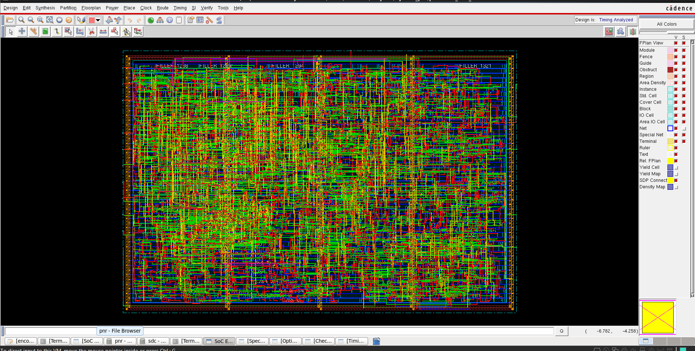
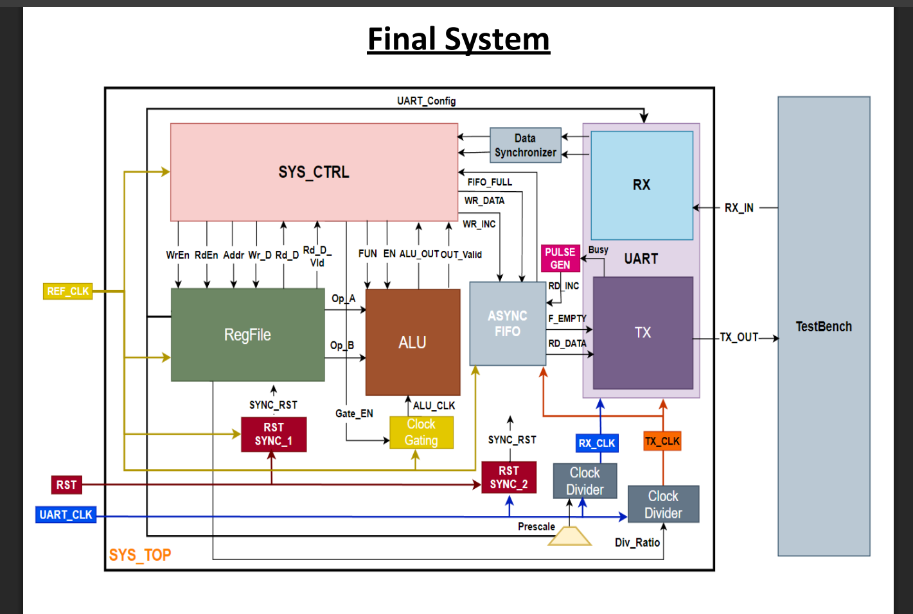
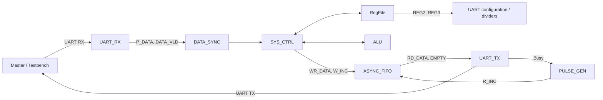
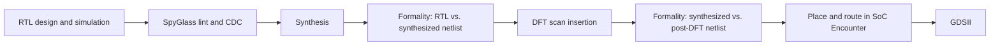
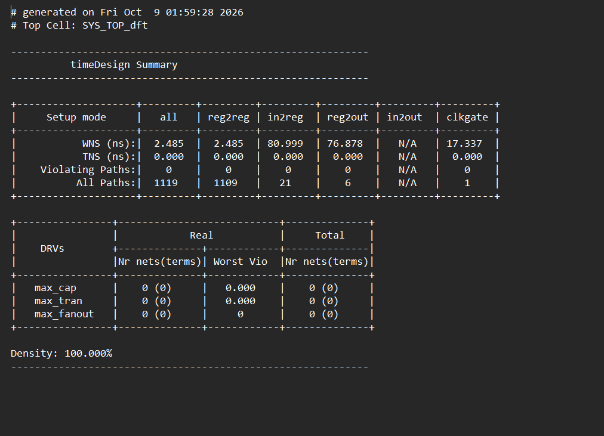
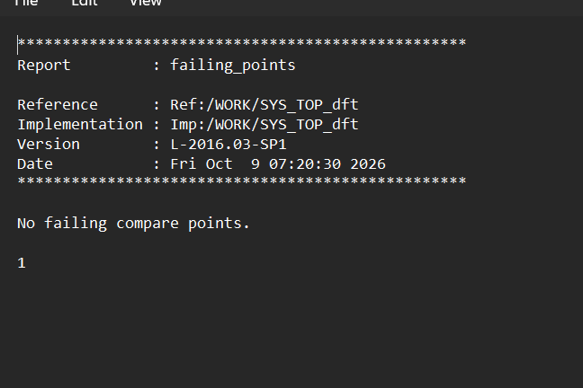
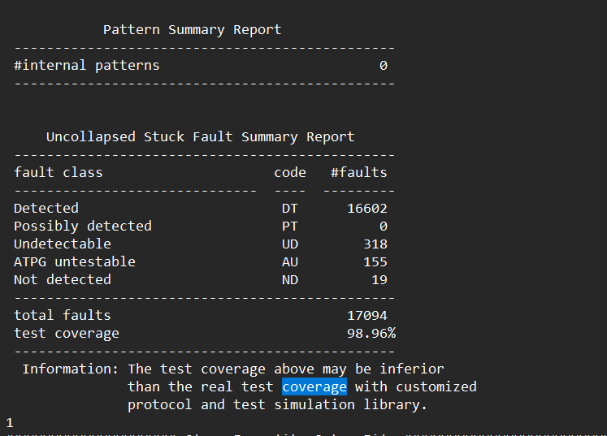

# SYS_TOP: UART-Controlled RTL-to-GDSII Design

A UART-controlled digital system with two clock domains, documented for an RTL-to-GDSII implementation flow. The project description covers RTL simulation, lint and clock-domain-crossing (CDC) analysis, synthesis, formal equivalence, design-for-test (DFT), place and route, and GDSII generation.



## Contents

- [Overview](#overview)
- [Specifications](#specifications)
- [Architecture](#architecture)
- [Clocks, resets, and CDC](#clocks-resets-and-cdc)
- [UART command protocol](#uart-command-protocol)
- [Register map](#register-map)
- [Design flow and results](#design-flow-and-results)
- [Repository layout](#repository-layout)
- [Reproducing the flow](#reproducing-the-flow)
- [Tools](#tools)
- [Resolved documentation issues and remaining evidence](#resolved-documentation-issues-and-remaining-evidence)
- [Assumptions and limitations](#assumptions-and-limitations)
- [Author](#author)

## Overview

The testbench acts as the UART master. It sends command frames to `UART_RX`; `SYS_CTRL` decodes each command and uses the register file or ALU to perform the requested operation. Responses pass through an asynchronous FIFO and are transmitted by `UART_TX`.

The design description identifies ten functional blocks across two clock domains, with synchronizers or a FIFO used at the domain boundaries.



### Supported operations

- **ALU:** add, subtract, multiply, divide, AND, OR, NAND, NOR, XOR, XNOR, compare equal, compare greater-than, shift right by one, and shift left by one.
- **Register file:** read and write.

## Specifications

| Item | Specification |
|---|---|
| Reference clock (`REF_CLK`) | 50 MHz |
| UART clock (`UART_CLK`) | 3.6864 MHz |
| Data width (`DATA_WIDTH`) | 8 bits, parameterized |
| Register address width | 4 bits in the documented interface |
| Scan chains (`NUM_OF_CHAINS`) | 3 |
| Reset | Active-low; asynchronous assertion and synchronized release |
| UART defaults | Parity enabled, parity type 0, prescale 32, divider ratio 32 |
| Default baud rate | 115,200 baud, assuming `UART_CLK / 32` |

### Top-level ports

| Port | Direction | Width | Description |
|---|---|---:|---|
| `REF_CLK` | Input | 1 | System clock |
| `UART_CLK` | Input | 1 | UART-domain clock |
| `RST_N` | Input | 1 | Active-low reset |
| `UART_RX_IN` | Input | 1 | UART serial input |
| `UART_TX_O` | Output | 1 | UART serial output |
| `parity_error` | Output | 1 | Received-frame parity error |
| `framing_error` | Output | 1 | Received-frame stop-bit error |
| `scan_clk` | Input | 1 | DFT scan clock |
| `scan_rst` | Input | 1 | DFT scan reset |
| `test_mode` | Input | 1 | Selects test-mode clock/reset paths |
| `SE` | Input | 1 | Scan enable |
| `SI` | Input | `NUM_OF_CHAINS` | Scan data input, one bit per chain |
| `SO` | Output | `NUM_OF_CHAINS` | Scan data output, one bit per chain |


## Architecture

| Clock domain / mechanism | Blocks |
|---|---|
| `REF_CLK` | `RegFile`, `ALU` clock-gating control, `CLK_GATE`, `SYS_CTRL`, FIFO write side |
| `UART_CLK` and derived clocks | `UART_TX`, `UART_RX`, `PULSE_GEN`, two `ClkDiv` instances, FIFO read side |
| Clock-domain crossing | Two `RST_SYNC` instances, `DATA_SYNC`, `ASYNC_FIFO` |



`SYS_CTRL` coordinates the register file, ALU, clock gate, FIFO write side, and received UART data. `REG0` and `REG1` are documented as ALU operands; `REG2` configures UART behavior; and `REG3` sets the transmit clock divider. The ALU is clocked when enabled by the controller. Results cross into the transmit domain through `ASYNC_FIFO`. `PULSE_GEN` converts the transmitter's busy signal into a one-cycle FIFO read pulse.

## Clocks, resets, and CDC

### Clocks

| Clock | Source | Frequency / ratio described | Used by |
|---|---|---|---|
| `REF_CLK` | Top-level input | 50 MHz | Register file, controller, clock gate, FIFO write side |
| `ALU_CLK` | `CLK_GATE` from `REF_CLK` | 50 MHz when enabled; divide by 1 | ALU |
| `UART_CLK` | Top-level input | 3.6864 MHz | Dividers and UART-domain logic |
| `RX_CLK` | `ClkDiv` from `UART_CLK` | Divide by 1 by default | UART receiver, according to the clock table |
| `TX_CLK` | `ClkDiv` from `UART_CLK` | Divide by 32 by default | UART transmitter, pulse generator, FIFO read side |
| `scan_clk` | Top-level input | Test-mode clock | Scan flops through test-mode clock muxes |

The transmit divider ratio is documented as coming from `REG3`. The receive prescale is documented as `REG2[7:2]`, with a default of 32 samples per bit. The divider enable, `clk_div_en`, is described as tied high.

**Baud-rate clarification:** `3.6864 MHz / 32 = 115.2 kHz`, which is the documented divided-clock frequency, not by itself proof of the UART baud rate. The stated 115,200 baud is consistent with 3.6864 MHz divided by 32 when that divider/prescale is used as the UART bit timing factor. Confirm the actual timing implementation in `ClkDiv`, `UART_TX`, and `UART_RX`.

### Reset and crossings

`RST_N` is described as asynchronously asserted. `RST_SYNC_1` synchronizes reset release to `REF_CLK`, and `RST_SYNC_2` synchronizes release to `UART_CLK`. In test mode, the design selects `scan_clk` and `scan_rst`.

| Signal crossing | Direction | Documented mechanism |
|---|---|---|
| Received UART byte | UART receive domain → `REF_CLK` | `DATA_SYNC` (data bus and enable pulse) |
| Result bytes | `REF_CLK` → transmit domain | `ASYNC_FIFO` |
| Reset | Asynchronous input → each clock domain | Per-domain `RST_SYNC` |
| UART configuration (`REG2`, `REG3`) | `REF_CLK` → UART domain | Quasi-static registers, written before traffic |

The project description identifies SpyGlass CDC analysis as the check for these crossings. A clean CDC result cannot be claimed without the corresponding report.

## UART command protocol

Each command consists of 8-bit UART frames. The first frame is the command byte.

| Command | Code | Number of frames | Frame sequence |
|---|---:|---:|---|
| Register write | `0xAA` | 3 | Command, address, data |
| Register read | `0xBB` | 2 | Command, address |
| ALU with new operands | `0xCC` | 4 | Command, operand A, operand B, ALU function |
| ALU with stored operands | `0xDD` | 2 | Command, ALU function |

### Responses

| Command | Operation | Response behavior described |
|---|---|---|
| `0xAA` | Write data to an address | The controller performs a register-file write; a separate response frame is not specified in the supplied description |
| `0xBB` | Read an address | One frame containing the read data |
| `0xCC` | Load operands and execute an ALU function | Result format may be one or two frames, depending on the operation |
| `0xDD` | Execute on stored operands | Result format may be one or two frames, depending on the operation |

Example command sequences:

- Write `0x5A` to address `0x4`: `AA 04 5A`
- Read address `0x4`: `BB 04`
- Add 5 and 3: `CC 05 03 <ADD code>`
- Execute a function on stored operands: `DD <function code>`

**ALU function encodings:** The supplied README describes the supported operations but does not include their numeric `ALU_FUN` encodings or the ALU RTL. Therefore, exact function-code bytes cannot be reliably filled in from this file alone. Read the `ALU_FUN` case statement or its local parameters in the ALU RTL before sending command frames; do not assume an encoding based only on operation order.

## Register map

The interface description uses a 4-bit register address. A 4-bit address can represent only `0x0` through `0xF`, so the documented general-purpose range `0x4`–`0x15` cannot be represented in full. The consistent range for a 4-bit interface is `0x4`–`0xF`; use that range unless the RTL proves the address bus is wider.

| Address | Register | Purpose | Default / reset value |
|---|---|---|---|
| `0x0` | `REG0` | ALU operand A, according to the interface table | Not specified in the supplied documentation |
| `0x1` | `REG1` | ALU operand B, according to the interface table | Not specified in the supplied documentation |
| `0x2` | `REG2` | UART configuration | Documented settings: parity enabled, parity type 0, prescale 32 |
| `0x3` | `REG3` | Transmit clock-divider ratio | 32 |
| `0x4`–`0xF` | General-purpose registers, subject to RTL implementation | Read/write storage | Not specified in the supplied documentation |

The `REG0`/`REG1` operand mapping follows the explicit interface table. The reset values for `REG0`, `REG1`, and the general-purpose registers must be read from the register-file RTL; no reset values are asserted here without that evidence.

### `REG2` (`0x2`): UART configuration

| Bits | Field | Meaning | Documented default |
|---|---|---|---:|
| `[0]` | Parity enable | Enables parity when set | 1 |
| `[1]` | Parity type | Selects the parity type; exact encoding should be confirmed in RTL | 0 |
| `[7:2]` | Prescale | Receive oversampling factor | 32, as stated in the design description |

The documented default prescale of 32 should be checked against the actual field encoding and reset assignment, since a six-bit field and the exact register value depend on the RTL's representation.

### `REG3` (`0x3`): transmit divider

| Bits | Field | Meaning | Documented default |
|---|---|---|---:|
| `[7:0]` | Division ratio | Divides `UART_CLK` to generate the transmit clock | 32 |

Confirm the divider's odd/even-ratio behavior, counter implementation, and reset value in the clock-divider RTL.

## Design flow and results



### Flow summary

1. **RTL and simulation:** Run the testbench and check functional behavior.
2. **Lint and CDC:** Run SpyGlass on the RTL and review all relevant violations and waivers.
3. **Synthesis:** Run the synthesis script and review the synthesis log, timing reports, and area reports.
4. **Formal equivalence:** Compare RTL with the synthesized netlist using Formality.
5. **DFT:** Prepare the DFT-ready top-level/netlist, define scan signals and protocol, run DRC, and insert scan chains. The project description states a fault-coverage target above 98%; this is a target, not evidence of achieved coverage.
6. **Post-DFT equivalence:** Compare the synthesized and post-DFT netlists using Formality.
7. **Place and route:** Import the post-DFT netlist, SDC, libraries, and LEF files into SoC Encounter. Complete floorplanning, power planning, placement, clock-tree synthesis, routing, and physical verification.
8. **Stream out:** Generate the final GDSII layout.

The documented constraint set includes 50 MHz `REF_CLK` and 3.6864 MHz `UART_CLK` master clocks, generated clocks, 0.2 ns setup uncertainty, 0.1 ns hold uncertainty, asynchronous clock groups, input/output delays, input driving cells, output loads, and slow/fast operating conditions. DFT constraints add `scan_clk`, scan I/O timing, and scan-mode case analysis. The actual constraint files should be checked to confirm these settings and the generated-clock source relationships.

### Results

No numeric SpyGlass, synthesis, Formality, DFT, or place-and-route report values were included in the supplied README. Consequently, the table below records what evidence is needed rather than presenting invented measurements.

| Stage | Metric to report | Evidence required |
|---|---|---|
| SpyGlass | CDC violations and lint warnings | SpyGlass lint/CDC reports, including waiver status |
| Synthesis | Setup slack, hold slack, cell area | Synthesis timing and area reports |
| Formality (post-synthesis) | Equivalence pass/fail | Formality run summary |
| DFT | Fault coverage and timing slack | DFT coverage and timing reports |
| Formality (post-DFT) | Equivalence pass/fail | Post-DFT Formality run summary |
| Place and route | Utilization, post-route slack, DRC status | PnR timing, utilization, and physical-verification reports |
| Final layout | Die/core area and GDSII generation status | Final floorplan/area report and successful stream-out log |

### Screenshots

The repository description references the following images. Ensure each file exists at the stated path before relying on the image in this README.

| GDSII layout | Block diagram |
|---|---|
|  |  |

| SpyGlass CDC | Post-route timing |
|---|---|
|  |  |

| Formality | DFT coverage |
|---|---|
|  |  |

## Repository layout

```text
SYS_TOP/
├── rtl/            Verilog source, including SYS_TOP and DFT-related RTL
├── tb/             Testbenches
├── constraints/    Timing constraints, including cons.tcl
├── scripts/        Synthesis, DFT, Formality, and PnR scripts
├── reports/        Timing, area, power, DFT, SpyGlass, and Formality reports
├── netlists/       Synthesized and post-DFT netlists
├── pnr/            Place-and-route results and final GDSII
├── docs/           Diagrams and screenshots
├── .gitignore
└── README.md
```

This is the intended repository organization described by the project notes; verify the actual directory and filenames before running commands.

## Reproducing the flow

The supplied documentation does not provide complete, verified simulator or EDA command lines, and the actual scripts were not included in the available material. Use the commands and setup required by the installed tool versions and project scripts rather than copying unverified commands.

1. Set up the project by copying the `System` folder into `Projects` under `IC`, as described in the project notes.
2. Run the RTL testbench from `tb/` with the simulator configured for the project.
3. Run SpyGlass lint and CDC analysis; review violations and waivers.
4. Run synthesis using the project script and `cons.tcl`; review `syn.log`, setup/hold timing, and area.
5. Run Formality on RTL versus the synthesized netlist.
6. Run the DFT script; review `dft.log`, timing, and fault coverage.
7. Run Formality on the synthesized versus post-DFT netlists.
8. Run place and route in SoC Encounter using the post-DFT netlist, SDC, libraries, and LEF files.
9. Review post-route timing and physical-verification results, then stream out GDSII.

Before running the flow, verify that all required RTL files, testbenches, scripts, libraries, technology files, LEFs, and constraints are available. The supplied README specifically notes that technology libraries and PDK files are not included in its documented material.

## Tools

| Purpose | Tool |
|---|---|
| RTL | Verilog |
| Lint and CDC | SpyGlass |
| Synthesis | Synopsys Design Compiler |
| DFT | Synopsys DFT Compiler |
| Equivalence checking | Synopsys Formality |
| Place and route / GDSII | Cadence SoC Encounter |

Tool versions and technology-library configuration should be recorded in the project environment for reproducibility.

## Resolved documentation issues and remaining evidence

The following changes make the documentation internally consistent where the supplied information supports a correction. Items that depend on RTL or implementation reports are explicitly identified rather than guessed.

| Topic | Documentation treatment | What is needed for final confirmation |
|---|---|---|
| Register address range | Corrected the documented usable range to `0x4`–`0xF` for a 4-bit address bus. The original `0x4`–`0x15` range cannot be represented by four bits. | Confirm the actual register-file address width and decode logic in RTL. |
| ALU function codes | Listed supported operations, but did not invent numeric command codes. | ALU RTL `case` statement, local parameters, or command-protocol source. |
| `REG0`/`REG1` mapping | Followed the interface table: `REG0` = operand A and `REG1` = operand B. | Confirm register assignments and controller behavior in RTL. |
| Register reset values | Marked undocumented reset values as unspecified instead of assuming zero. | Register-file reset logic and reset simulation. |
| ALU result width | Recorded the documentation discrepancy: one description says the default ALU output is 8 bits, while the controller interface is described as 16 bits. | Actual ALU module parameter and port declarations, multiplication logic, and controller wiring. |
| Receive clock | Recorded both descriptions: a divide-by-1 generated `RX_CLK` and a receiver driven directly by `UART_CLK`. | `ClkDiv` and `UART_RX` instantiation/wiring plus generated-clock constraints. |
| `PULSE_GEN` clock | The architecture indicates it should operate in the transmit clock domain, but the source description is ambiguous. | `PULSE_GEN` instantiation and its clock connection in top-level RTL. |
| FIFO read clock | The architecture indicates the FIFO read side is in the transmit domain. | `ASYNC_FIFO` instance port wiring and reset connections. |
| Reset synchronizer ports | Described the intended behavior without relying on the potentially swapped signal labels in the design notes. | `RST_SYNC` module port declarations and instance connections. |
| UART RX port naming | Used the documented top-level name `UART_RX_IN` consistently in this README. | Actual `SYS_TOP` module declaration and testbench connections. |
| Baud-rate wording | Distinguished the divided clock frequency from the UART baud rate. | `UART_TX`, `UART_RX`, and divider timing logic. |
| Implementation results | Removed placeholder result values and specified the reports needed for each metric. | Actual tool reports and logs. |
| Reproduction commands | Documented the flow without inventing command lines absent from the available materials. | Actual scripts, tool setup, and version-specific invocation details. |
| Technology files | Identified the libraries/PDK as prerequisites not supplied in the available material. | Foundry/PDK package, standard-cell libraries, LEF/tech LEF, and corner files. |

## Assumptions and limitations

- The README describes a design with an 8-bit default data width and a reported 16-bit controller ALU-result interface; the implemented widths must be confirmed from RTL.
- A 4-bit register address supports only `0x0`–`0xF`. This README uses `0x4`–`0xF` as the possible general-purpose address range, pending RTL confirmation.
- `REG2` and `REG3` are described as quasi-static across the clock-domain boundary and written before UART traffic begins. If software changes them during operation, the design must be reviewed for safe CDC handling.
- Numeric ALU function codes, reset values for undocumented registers, write acknowledgement behavior, exact ALU response framing, and actual test coverage are not specified by the supplied README.
- No measured synthesis, Formality, DFT, CDC, or place-and-route results are included in the supplied material. No pass/fail claims are made here.
- The actual RTL, testbench, scripts, reports, technology libraries, and PDK files were not provided with the README available for this rewrite. RTL-dependent details cannot be conclusively resolved until those files are inspected.

## Author

**Mahmoud Ahmed**

GitHub:   https://github.com/mahmoudahmed0521
LinkedIn:  www.linkedin.com/in/mahmoud-ahmed-064a18231